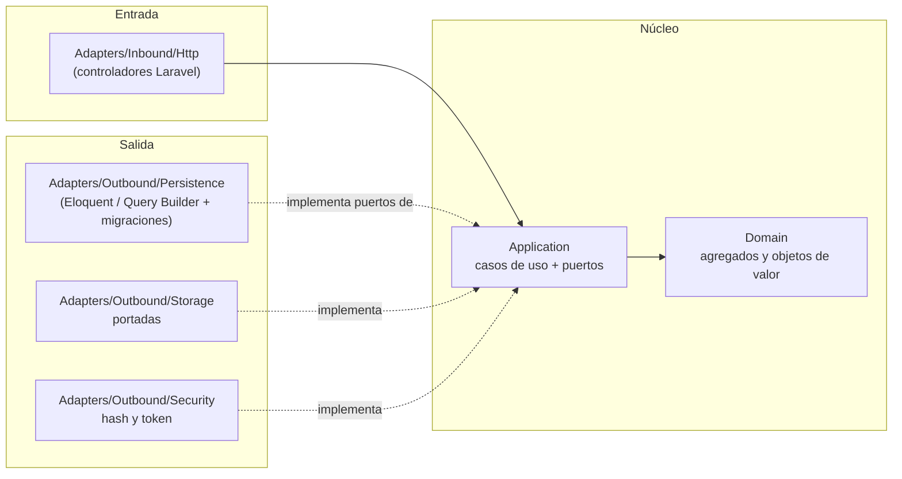
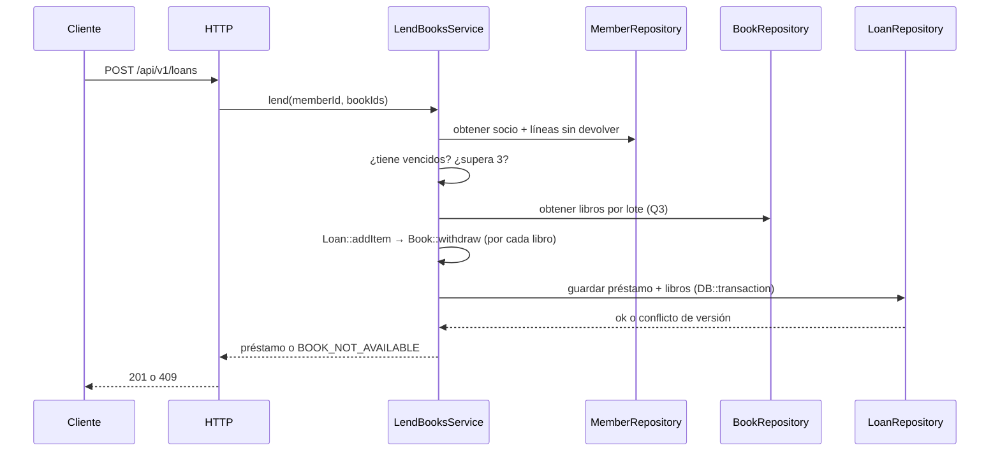

# Arquitectura — Manager Library (Laravel)

Arquitectura **hexagonal** (puertos y adaptadores). Las reglas de dependencia son los artículos I a III de [`constitution.md`](constitution.md).
Es la misma arquitectura de [`spec-python/architecture.md`](../spec-python/architecture.md) traducida a Laravel ([ADR-005](adr/adr-005-traduccion-a-react-y-laravel.md)).

## 1. Capas y dependencias



Las flechas de dependencia apuntan **hacia adentro**. `Bootstrap` es el único que ve las dos mitades.

## 2. Estructura de carpetas

```text
app/
├── Domain/                  # Book, Loan, LoanItem, Member, User; Isbn, Quantity, DateRange (PHP puro)
├── Application/
│   ├── Ports/Outbound/      # BookRepository, LoanRepository, MemberRepository, UserRepository,
│   │                        # ReportReader, Clock, PasswordHasher, TokenIssuer, CoverStorage (interfaces)
│   └── Services/            # LendBooksService, ReturnItemService, CreateBookService, SearchBooksService,
│                            # OverdueService, MostBorrowedReportService, LoginService, CreateLibrarianService
├── Adapters/
│   ├── Inbound/Http/        # controladores, validación de peticiones, middleware de token y rol, manejo de errores
│   └── Outbound/            # Persistence/, Storage/, Security/
└── Bootstrap/
    └── PortBindingsServiceProvider.php   # único punto de composición (artículo III)
database/migrations/         # todo el DDL (ADR-001)
routes/api.php               # solo las rutas de api-contract.md
tests/                       # Domain/, Application/, Integration/, Contract/, Architecture/
```

## 3. Agregados

| Raíz | Contiene | Invariantes que defiende |
|---|---|---|
| `Book` | `Isbn`, copias totales y disponibles, baja lógica | disponibles entre 0 y total; total ≥ 1; título no vacío |
| `Loan` | colección de `LoanItem` | 1 a 3 líneas; sin libro repetido; vencimiento a 14 días; inmutable salvo devolución |
| `Member` | documento | documento obligatorio y único |
| `User` | rol, hash | nombre normalizado; rol en (`admin`, `librarian`) |

`Loan::addItem` llama a `Book::withdraw` antes de añadir la línea: descontar el ejemplar y crear la línea son **una sola operación**.
`Loan::returnItem` llama a `Book::restock` una sola vez por línea.

## 4. Flujo: registrar un préstamo



## 5. Errores

El dominio y la aplicación lanzan excepciones propias (`BookNotAvailable`, `MemberHasOverdue`, `MemberLimitExceeded`, …). **Solo** el
adaptador HTTP (el manejador de excepciones registrado en `bootstrap/app.php`) las traduce al cuerpo único y al código de estado de
[`api-contract.md`](../spec-python/api-contract.md). Un error de framework (validación, ruta inexistente, 405, 500) nunca llega al cliente
con el formato de Laravel: también se traduce al cuerpo único, sin trazas.

## 6. Qué no hay

Sin eventos, sin colas, sin caché, sin microservicios, sin multi-tenencia. Se añaden si un requisito lo pide, no antes.
Tampoco se usan las piezas de Laravel que el spec no pide: sin Sanctum, sin sesiones, sin vistas Blade, sin rutas de ejemplo.
